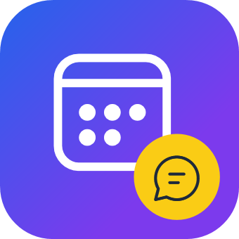
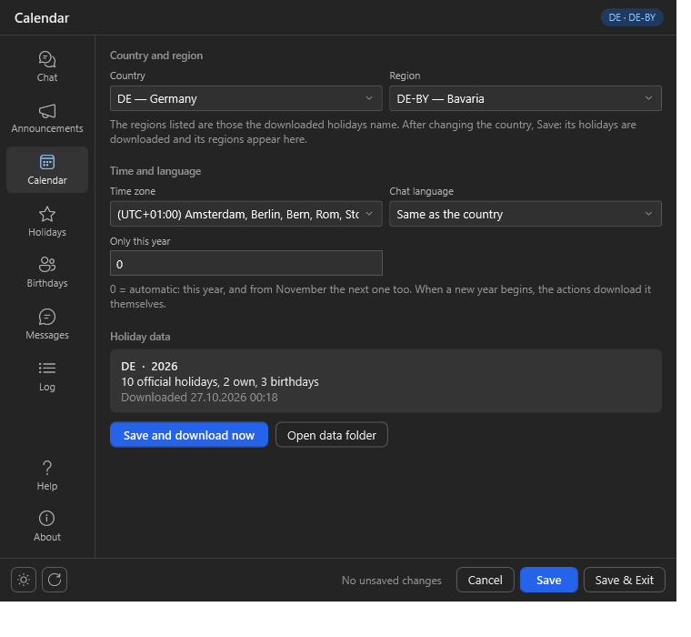

<p align="center">
  
</p>

<h1 align="center">Chat Calendar</h1>

<p align="center">
  <b>Holidays, birthdays and your own special days in your chat — on Twitch, YouTube and Kick.</b><br>
  Public holidays of 100+ countries, posted once a day to Discord, Stoat and GameVox if you like.
</p>

<p align="center">
  
  
  
  
  
</p>

<p align="center">
  <a href="https://github.com/aaskjer/ChatCalendar/releases"><b>Download</b></a> &nbsp;·&nbsp;
  <a href="Setup-Guide.md"><b>Setup Guide</b></a> &nbsp;·&nbsp;
  <a href="Import-String.md"><b>Import String</b></a> &nbsp;·&nbsp;
  <a href="CHANGELOG.md"><b>Changelog</b></a>
</p>

---

## 📖 Overview

Chat Calendar greets your chat on public holidays, on viewers' birthdays and on days you add yourself.
Every chatter is greeted once per holiday, also when the stream runs past midnight, and once on their
birthday. The greetings follow your country: German, French, Spanish and a dozen more languages.
Formerly *Twitch Calendar*.

```
mirabel_tv: hi chat!
YourBot: Happy 'Christmas Day', mirabel_tv!

kjell_plays: !birthday 22.7.
YourBot: Saved, kjell_plays: your birthday is on July 22.
```

## ✨ Highlights

- 🗓️ **Holidays for your region.** The holidays come from [date.nager.at](https://date.nager.at). Pick a
  region such as Texas, Ontario, Bavaria or Queensland, and only its holidays count. New years download
  themselves.
- 🎂 **Birthdays.** Viewers save their own with `!birthday 24.12.`, moderators set them for others. On the
  Birthdays page you add more, with a year for `{age}`.
- ⭐ **Your own days.** A channel birthday, a charity stream or anything else, once on a date or every year.
- 📣 **A daily post to Discord, Stoat and GameVox.** Today's holidays and birthdays go out through a webhook at
  the time you set. No Streamer.bot timer needed.
- 💬 **Answers in the chat they came from.** From the bot or the broadcaster account, on Twitch as a `/me`
  message if you like.
- ⚙️ **One settings window.** Country, region, time zone, every greeting with a chat preview, webhooks with a
  test button and a colour picker, and the log of what was said.

<p align="center"></p>

---

## Credits

- **Author:** [aaskjer on Twitch](https://twitch.tv/aaskjer) · [aaskjer.github.io](https://aaskjer.github.io/)
- **Built for:** [Streamer.bot](https://streamer.bot) by [nate1280](https://www.patreon.com/c/nate1280/home)
- **Data & services:**
  - [Nager.Date](https://date.nager.at): public holidays
  - [pronouns.alejo.io](https://pronouns.alejo.io) by Alejo: viewer pronouns on Twitch
- **Community:** [Chat Calendar on the Streamer.bot extensions forum](https://extensions.streamer.bot/t/twitch-calendar/2282)
- **Thanks:** YOU ♡

None of the services above is affiliated with or endorses Chat Calendar.
