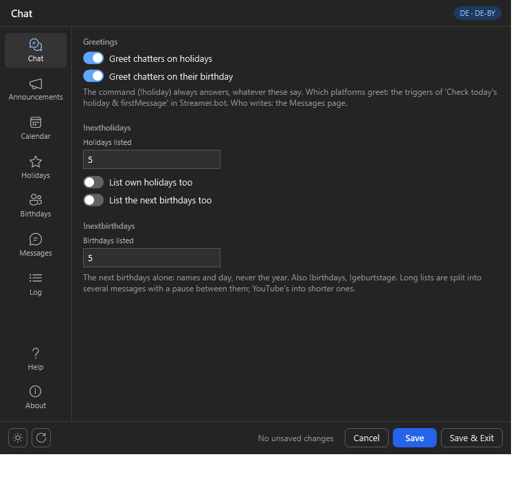
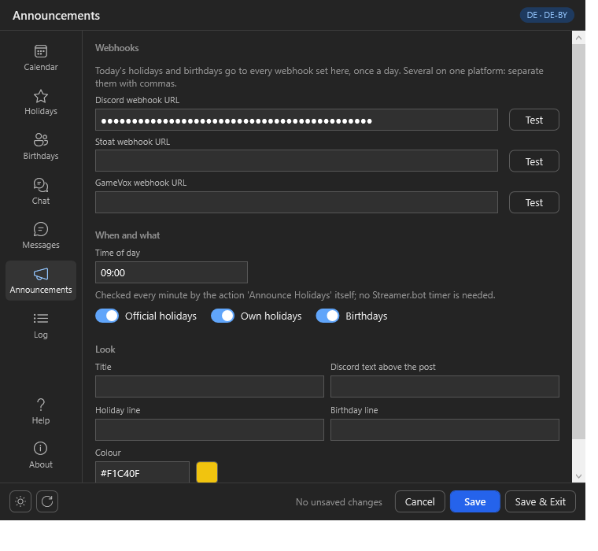
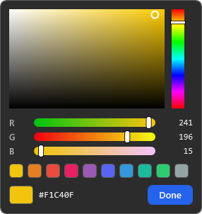
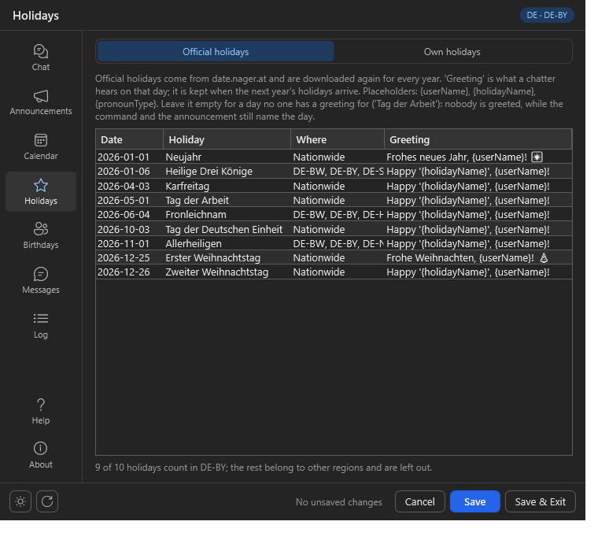
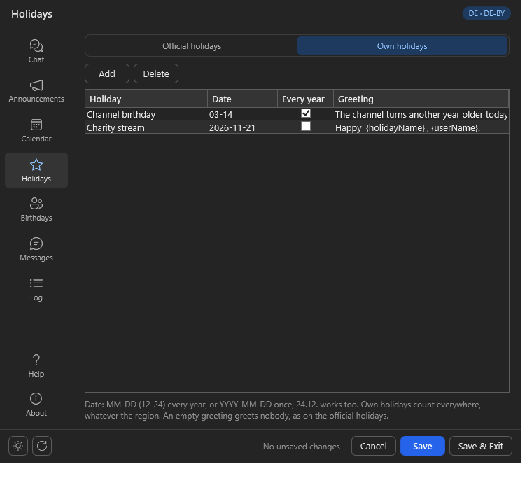
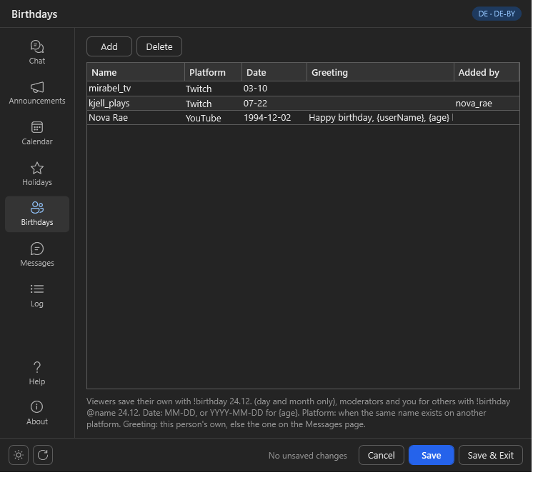
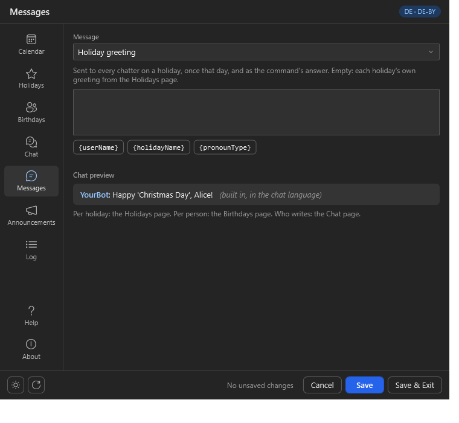
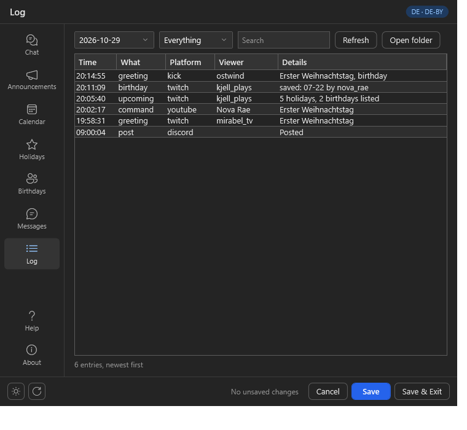

# Import

Click `Import` in [Streamer.bot](https://streamer.bot/) and drag the
[ChatCalendar.sb](https://github.com/aaskjer/ChatCalendar/releases) file into the window, or paste the
[import string](Import-String.md). Click `Import`, then `Yes` on the popups that follow.

You get six actions in the group `ChatCalendar`:

| Action | What it is for |
|---|---|
| `[CC] - .Settings` | Opens the Settings window. |
| `[CC] - Calendar Setup` | Downloads the holidays. Nothing to run here: it starts by itself when the Settings window opens without holidays, when you save another country or region, when a new year begins, and from `Save and download now`. |
| `Check today's holiday & firstMessage` | Greets the chat; answers `!holiday`. |
| `Upcoming Holidays` | Answers `!nextholidays` and `!nextbirthdays`. |
| `Birthday Command` | Answers `!birthday`. |
| `Announce Holidays` | Posts to Discord, Stoat and GameVox once a day. |

## Enable Commands

The commands ship disabled. Go to `Commands`, enable the four `ChatCalendar - ...` commands and tick
the platforms they should answer on (Twitch, YouTube, Kick) under their sources.

Which chats are greeted is up to the triggers of `Check today's holiday & firstMessage`: Twitch, YouTube
and Kick chat messages. Untick one to leave that platform out.

# Setup

Go to `Actions`, select `[CC] - .Settings`, right-click the `Test` trigger and choose
`Test Trigger`. That opens the Settings window.

The first time it opens, the window downloads the holidays of your country by itself; the Calendar page
shows how far it is. Nothing has to be run in `[CC] - Calendar Setup`.

Seven pages sit on the rail down the left side — Chat, Announcements, Calendar, Holidays, Birthdays,
Messages, Log —, Help and About at its foot. `Ctrl+1` to `Ctrl+9` jump
between them, `Ctrl+S` saves. The sun or moon at the bottom left switches between the dark and light
theme; the arrow next to it puts the page you are on back to its defaults. Nothing is written until you
press `Save`.

Everything lands in the folder `Chat Calendar` next to Streamer.bot: `configs.json` (this window),
`holidays.json`, `birthdays.json` and the `Logs` folder.

## Chat

Whether chatters are greeted on holidays and on their birthday — the command answers either way. Below,
`!nextholidays`: how many holidays it lists, and whether your own holidays and the next birthdays
follow; and `!nextbirthdays`, which lists the next birthdays alone: how many of them.

## Announcements

Paste a webhook URL for each platform to post to; several on one platform are separated by commas.
The URLs stay covered: the eye beside one shows it, and clicking elsewhere or leaving the page covers it again.
`Test` saves and posts today's holidays right away (a test post on a day without one).

- **Discord:** channel settings → `Integrations` → `Webhooks` → `New Webhook` → `Copy Webhook URL`.
- **Stoat:** channel settings → `Webhooks`; the URL looks like `https://api.stoat.chat/webhooks/<id>/<token>`.
- **GameVox:** Developer Portal → your application → `Webhooks` → the execute URL (cloud-hosted servers only).

The post goes out once a day at the time you set, in the time zone of the Calendar page. Title, the line
per holiday and per birthday, the colour and a Discord text above the post (a role mention, say) are
yours to change. Click the colour swatch for a picker: click or drag in the field and the hue bar, or
use the red, green and blue sliders and the colours below them.

## Calendar

Your **country**, and the **region** whose holidays count: some are only holidays in parts of a country
(Epiphany in Baden-Württemberg, Bavaria and Saxony-Anhalt). `All regions` greets everyone for each of
them, a region keeps the nationwide ones and its own, `Nationwide holidays only` keeps those alone.
Of the 204 countries, 17 have holidays that differ by region; each of those is listed with every one of
its regions — all 50 US states, every Canadian province, every Bundesland — and the rest with none.
After changing the country, `Save` downloads its holidays and the list follows. The Holidays page then
shows the holidays of that region alone — Bavaria has no Reformation Day.

The **time zone** sets when a day begins — midnight for your viewers, not on the PC's clock. The **chat
language** is the language of every text the actions write; by default it follows the country.
`Boarisch` writes Bavarian; `Deutsch` or the default for Germany, Austria and Switzerland is standard German.

`Save and download now` downloads every year again. Saving another country, region, time zone or year
runs the download too.

## Holidays

**Official holidays** come from date.nager.at, and only those that count in your region are listed.
Where that source leaves a region out, Setup adds it: Mariä Himmelfahrt counts in Bavaria, not in
Saarland alone — it is a holiday in the Bavarian municipalities with a Catholic majority, most of them.
The `Greeting` column is what a chatter hears on that day; it is kept when next year's holidays arrive.
Leave it empty for a day no one has a greeting for — nobody wishes a happy Labour Day: then nobody is
greeted for it, while `!holiday` still names the day and the announcement still lists it.

**Own holidays** are yours. `MM-DD` (or `24.12.`) comes back every year; with `Every year` off the date
counts once. They count everywhere, whatever the region, and an empty greeting greets nobody here too.

Placeholders: `{userName}`, `{holidayName}`, `{pronounType}` (he, she or they from Twitch pronouns).

## Birthdays

Everyone the chat congratulates. Viewers add themselves with `!birthday 24.12.`; add others here.
A date with a year (`1994-12-02`) knows the age for `{age}`; the command never keeps the year.
`Platform` matters only when the same name exists on another platform. A greeting here replaces the
one on the Messages page for that person.

## Messages

Your own texts for the holiday greeting, the birthday greeting and the answer on a day without a
holiday. Empty means the built-in text in the chat language. Click a placeholder to insert it; the
preview shows the message as the chat will see it.

Under the preview: whether every message comes from your bot account or the broadcaster's, and `/me`
on Twitch (YouTube and Kick have none and get a plain message).

## Log

What was said and posted, newest first: greetings, commands, birthdays saved, webhook posts, downloads and
errors. One file a day in `Logs`, kept for 30 days.

# Updating from Twitch Calendar

Import over the old version. The holidays (`C:\streamer.bot\Twitch Calendar` or `Twitch Calendar` next to
Streamer.bot) are copied into `Chat Calendar` on the first run, with your own holidays and greetings. The
country, region and time zone come along; webhook URLs and your own texts from the old Set Argument
sub-actions are entered once in the Settings window.
